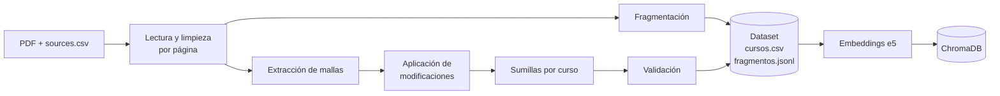

# Informe de Avance N.° 1 — Ingesta de datos y base vectorial

**Proyecto:** API RAG de mallas curriculares — Facultad de Ciencias Matemáticas, UNMSM
**Grupo:** 09
**Fecha:** 10 de noviembre de 2026
**Alcance de este avance:** construcción del dataset a partir de los PDF oficiales y carga inicial de la base de datos vectorial (ChromaDB). El motor RAG (LLM) y la API todavía no forman parte de este avance.

---

## 1. Objetivo

Convertir los documentos curriculares (PDF en formatos heterogéneos) en datos estructurados y verificables, y cargarlos en una base de datos vectorial que permita buscar cursos por dato exacto y por tema.

| Etapa del proyecto (propuesta, sección 4.2) | Estado |
|:--|:--|
| 1. Datos | ✅ Completado |
| 2. Extracción | ✅ Completado (las 4 escuelas; Investigación Operativa por OCR) |
| 3. Validación | ✅ Validación automática |
| 4. Indexación | ✅ Carga inicial en ChromaDB |
| 5. Motor RAG | Pendiente |
| 6. API | Pendiente |
| 7. Evaluación | Pendiente |

---

## 2. Corpus procesado

19 PDF de 4 escuelas (≈420 páginas), registrados en `data/sources.csv` con su URL oficial y fecha de descarga.

| Escuela | Planes | Documentos |
|:--|:--|:--|
| Computación Científica | 2018 (+ modificaciones 2021 y 2026), 2026 (no oficial) | 6 |
| Matemática | 2018 | 3 |
| Estadística | 2018 (+ modificación 2021), 2023 | 8 |
| Investigación Operativa | 2018 (modificación 2020, escaneada) | 2 |

---

## 3. Pipeline de ingesta

Un script ejecutado manualmente (`python -m ingesta`) es el **único proceso que escribe** en la base de datos.



| Etapa | Qué se hace | Herramienta |
|:--|:--|:--|
| Inventario | Lee `sources.csv` y comprueba que cada PDF exista | Python |
| Lectura y limpieza | Texto por página; corrige acentos del PDF en LaTeX, quita sellos de verificación y encabezados repetidos, y excluye páginas con datos personales (listas de correos) | PyMuPDF |
| Fragmentación | Ventanas de ~220 palabras con solapamiento de 40, sin cruzar páginas, para que la cita de página sea exacta | Python |
| Extracción de mallas | Convierte las tablas en cursos: código, nombre, ciclo, créditos, tipo y prerrequisitos | pdfplumber, PyMuPDF |
| OCR | Lee la malla escaneada: detecta la cuadrícula de cada tabla y reconoce el texto de cada celda | OpenCV, EasyOCR |
| Modificaciones | Aplica las resoluciones posteriores en orden de fecha y registra qué resolución cambió cada curso | Python |
| Prerrequisitos | Convierte el texto ("Cálculo II y Matemática Básica") en códigos de cursos del mismo plan | rapidfuzz |
| Sumillas | Asocia cada sumilla a su curso comparando el título con los nombres de la malla | rapidfuzz |
| Validación | Esquema de cada registro (créditos, ciclo, tipo) e identificadores únicos | Pydantic |
| Dataset | Escribe `cursos.csv` y `fragmentos.jsonl` | Pandas |
| Indexación | Genera los embeddings y carga las colecciones (con copia de respaldo previa) | Sentence Transformers, ChromaDB |

### 3.1. Formatos de PDF encontrados y cómo se leen

Las tablas de cada escuela tienen columnas distintas en orden, nombre y celdas combinadas. Por eso el extractor clasifica cada celda **por su contenido** (código, número o texto) y no por su posición fija.

| Formato | Documentos | Estrategia |
|:--|:--|:--|
| Tabla con bordes | Planes 2018 de CC, Matemática y Estadística; Estadística 2023 (pág. 1) | Extracción de tablas |
| Tabla sin bordes | Estadística 2023 (pág. 2) | Lectura del texto línea por línea |
| Documento LaTeX | Plan 2026 de CC | Lectura del texto lineal + corrección de acentos |
| "Dice / Debe decir" | RR 012451-2026 (CC) | Solo se aplican las páginas "Debe decir" |
| Sumillas en prosa | 6 documentos | Título del curso + texto siguiente |
| Malla gráfica | Mallas de Matemática y Estadística | No se extraen cursos; la de Matemática es solo imagen |
| Escaneado | Anexo de Investigación Operativa | OCR por celdas (sección 3.2) |

### 3.2. OCR de la malla escaneada (Investigación Operativa)

El anexo de la RR N° 01937-R-20 son 7 páginas escaneadas. Su capa de texto original es ilegible, por lo que se reconoce de nuevo:

1. Cada página se convierte en imagen a 300 dpi.
2. Con operaciones morfológicas (OpenCV) se detectan las líneas de cada tabla: las horizontales delimitan las filas y las verticales, las columnas.
3. Cada fila se lee con **EasyOCR** (modelo en español, en CPU) y cada texto se asigna a la columna en la que cae.
4. Los números sueltos en cursiva (créditos y horas) se leen celda por celda, solo con dígitos, porque el detector general los omitía.
5. **Validaciones:** los créditos deben cumplir la regla de estos planes, *créditos = T + (P + L) / 2*. La suma de créditos de cada ciclo debe coincidir con el *Total* impreso; si un solo curso no cuadra, se corrige con la diferencia.
6. Los nombres se corrigen comparándolos (rapidfuzz) con los de las mallas de texto nativo, por ejemplo "Realidad Vacional" → "Realidad Nacional".

**Resultado:** 55 cursos (45 obligatorios y 10 electivos), cuya suma de créditos obligatorios por ciclo coincide con los totales del documento (206). Se eligió EasyOCR en lugar de Tesseract porque se instala como dependencia del proyecto (uv), sin un instalador del sistema. El OCR tarda ≈ 3.5 min la primera vez y su resultado se guarda en caché (`data/processed/ocr/`).

---

## 4. Resultados: el dataset

| Carrera | Plan | Cursos | Con sumilla | Créditos obligatorios |
|:--|:--|--:|--:|--:|
| Computación Científica | 2018 | 68 | 55 | 231 |
| Computación Científica | 2026 (no oficial) | 67 | 66 | 188 |
| Estadística | 2018 | 57 | 57 | 211 |
| Estadística | 2023 | 57 | 56 | 212 |
| Investigación Operativa | 2018 | 55 | 0 | 206 |
| Matemática | 2018 | 74 | 39 | 199 |
| **Total** | | **378** | **273** | |

- **Fragmentos de texto:** 1018, de 18 documentos (la malla de Matemática es solo imagen).
- **Errores de validación:** 0. **Identificadores duplicados:** 0.
- **Modificaciones aplicadas:** la RR 012451-2026 cambió los prerrequisitos de *Proyecto de Investigación* (183084) y *Desarrollo del Proyecto de Investigación* (183094) de CC 2018. Ambos registros indican la resolución que los modificó.

**Archivos generados:**
- `data/processed/cursos.csv`: un curso por fila, con sumilla y fuente (documento y página).
- `data/processed/fragmentos.jsonl`: un fragmento de texto por línea, con carrera, plan, documento, página y calidad.

---

## 5. Base de datos vectorial (ChromaDB)

**Modelo de embeddings:** `multilingual-e5-small`, ejecutado localmente en CPU. Cada texto se convierte en un vector de **384 dimensiones**, comparado por similitud de coseno.

| Colección | Registros | Texto vectorizado | Metadatos (filtros exactos) |
|:--|--:|:--|:--|
| `cursos` | 378 | Ficha: nombre, carrera, plan, ciclo, créditos, prerrequisitos y sumilla | `carrera`, `plan`, `codigo`, `curso`, `ciclo`, `creditos`, `tipo`, `prerrequisitos`, `documento`, `pagina`, `estado` |
| `fragmentos` | 1018 | Texto del fragmento | `carrera`, `plan`, `documento`, `pagina`, `tipo_documento`, `estado`, `calidad` |

### 5.1. Prueba de búsqueda

Búsqueda vectorial filtrada por carrera y plan (`python -m ingesta.inspeccionar`). Todavía no interviene el LLM: el resultado es la lista de cursos recuperados.

| Pregunta | Filtro | Primer resultado | Similitud |
|:--|:--|:--|--:|
| ¿En qué curso veré pilas y colas? | CC 2018 | Estructura de Datos (183044), ciclo 4 | 0.822 |
| ¿Dónde se enseña aprendizaje automático? | CC 2026 | Introducción al Aprendizaje de Máquina (AI263), ciclo 8 | 0.864 |
| Series de tiempo y pronósticos | Estadística 2023 | Modelos de Pronósticos (232083), ciclo 8 | 0.900 |
| Programación lineal y optimización | Investigación Operativa | Programación No Lineal y Dinámica (1814483), ciclo 8; luego Programación Lineal y Entera (1814444) | 0.876 |

**Observación:** en la primera pregunta, el segundo resultado quedó muy cerca (0.815). Las sumillas comparten frases genéricas ("la naturaleza del curso es teórico-práctica…"), lo que acerca los vectores entre sí. Esto respalda la hipótesis H2: añadir búsqueda léxica (BM25), donde la palabra "pilas" solo aparece en la sumilla correcta.

---

## 6. Consumo computacional

Medido en una PC de 16 núcleos lógicos, solo con CPU (sin usar GPU).

| Medida | Valor |
|:--|--:|
| Extracción completa (19 PDF → dataset), con el OCR en caché | ≈ 7 s |
| OCR de la malla escaneada (solo la primera vez) | ≈ 3.5 min |
| Generación de embeddings y carga en ChromaDB | ≈ 95 s |
| RAM máxima durante la indexación | ≈ 1.5 GB |
| Tamaño de la base `data/chroma/` | ≈ 30 MB |

El reporte de cada ejecución queda en `logs/ingesta.json`.

---

## 7. Limitaciones y pendientes

| Pendiente | Causa | Acción propuesta |
|:--|:--|:--|
| Sumillas de Investigación Operativa (55 cursos) | La escuela no las publica | Solicitarlas a la escuela |
| 50 cursos sin sumilla en otros planes | Cursos generales de CC 2018 (sus sumillas están en otra resolución) y electivos de Matemática no descritos en el documento | Buscar los documentos de sumillas faltantes |
| 15 electivos de Matemática sin créditos | La tabla del PDF no incluye esa columna | Completar desde otra fuente oficial |
| 7 prerrequisitos sin vincular | Abreviaturas en el PDF ("Prog. de Comp. II") | Tabla de abreviaturas |
| Horas T/P/L de algunos cursos de IO | El OCR omitió algunos dígitos; los créditos sí están completos y validados | No afecta el dataset (solo se guardan los créditos) |
| Plan 2026 de CC | No publicado oficialmente | Se indexa con `estado = no_oficial` |

---

## 8. Próximos pasos

1. Motor RAG: detección de intención, búsqueda híbrida (vectorial + BM25 con RRF) y generación de la respuesta con un LLM vía OpenRouter.
2. API de solo lectura con FastAPI (`POST /consultas` y endpoints de consulta).
3. Conjunto de preguntas de evaluación (`eval/preguntas.csv`) y medición de H1 y H2.

---

## Anexo: cómo reproducir

```bash
python -m uv sync
python -m uv run python -m ingesta --indexar
python -m uv run python -m ingesta.inspeccionar "¿En qué curso veré pilas y colas?" --carrera computacion --plan 2018
```

### Parámetros del script de inspección

En su primera versión, el script `ingesta.inspeccionar` interpretaba los argumentos según su **posición** (pregunta, carrera y plan, en ese orden). Si el usuario indicaba solo el plan, el valor se asignaba por error a la carrera y la búsqueda no devolvía resultados, sin ningún aviso. Para evitarlo, los filtros pasaron a ser **parámetros con nombre y opcionales**:

| Parámetro | Descripción | Valor por defecto |
|:--|:--|:--|
| `pregunta` | Texto de la consulta (único argumento posicional) | "¿En qué curso veré pilas y colas?" |
| `--carrera` | Nombre completo o parcial, sin distinguir tildes ni mayúsculas (p. ej. `computacion`) | Todas las carreras |
| `--plan` | Año del plan: `2018`, `2023` o `2026` | Todos los planes |
| `-n` | Número de resultados | 5 |
| `--sin-detalle` | Omite la descripción de las colecciones | Desactivado |

Si la carrera o el plan indicados no existen en la base, el script lo informa y muestra los valores disponibles.
