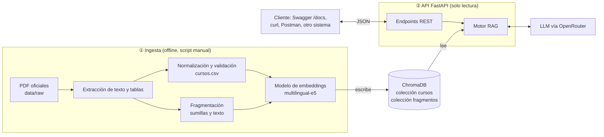
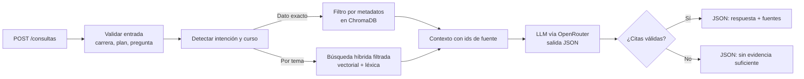

# Grupo 09 — Plan de proyecto RAG

## Integrantes

- Yanac Minaya Junior Alberto
- Tisnado Yarleque Christian David
- Quispe Gonzales Mark
- David Alejandro Tejada Ossio
- Illescas Vicente Alexander

---

# Proyecto 02 — API de consultas sobre mallas curriculares de la UNMSM mediante RAG

**API REST (FastAPI) que responde preguntas sobre los planes de estudio de la UNMSM con datos exactos y citas a documento y página**, mediante un RAG híbrido sobre los PDF oficiales: datos curriculares estructurados + recuperación semántica y léxica. No incluye interfaz gráfica: la entrada y la salida son JSON a través de endpoints.

**Flujo:** `Petición HTTP → Carrera, plan e intención → Consulta exacta y/o recuperación en ChromaDB → LLM (OpenRouter) → JSON con respuesta y fuentes`

---

## 1. Planteamiento del problema

Los planes de estudio de la UNMSM se publican como **PDF extensos y heterogéneos** (resoluciones rectorales con anexos, documentos de sumillas), con varias versiones de plan vigentes a la vez. Responder algo tan simple como *¿cuál es el prerrequisito de Base de Datos e Ingeniería de Software?* o *¿qué cursos tiene el quinto semestre?* obliga a ubicar el documento y la versión correctos y recorrer tablas de varias páginas.

> **Problema:** la información curricular es pública, pero **no es fácilmente consultable** en lenguaje natural ni por otros sistemas. Un chatbot genérico tampoco sirve: no conoce la malla de cada escuela e **inventa** cursos, créditos y prerrequisitos sin citar fuente.

**Objetivo:** desarrollar y evaluar una API basada en RAG que responda consultas curriculares (cursos por ciclo, créditos, prerrequisitos, obligatorios/electivos, sumillas) **con datos exactos y citas verificables**, aplicada a las cuatro escuelas profesionales de la **Facultad de Ciencias Matemáticas**: Computación Científica, Matemática, Estadística e Investigación Operativa.

---

## 2. Hipótesis

### 2.1. Enunciado

> **H1:** Un sistema RAG híbrido —que responde los datos exactos (créditos, ciclos, prerrequisitos) desde registros estructurados extraídos de los PDF oficiales, recupera texto con búsqueda semántica + léxica filtrada por carrera y plan, y obliga al LLM a citar la evidencia— **responde correctamente al menos el 85 % de las preguntas curriculares del conjunto de prueba**, con citas válidas en al menos el 90 % de las respuestas, **superando de forma clara a un LLM sin recuperación** sobre las mismas preguntas.

> **H2:** La recuperación híbrida (semántica + léxica) obtiene un **Recall@5 mayor** que la recuperación solo semántica, especialmente en preguntas que mencionan códigos o nombres exactos de cursos.

Los umbrales son metas iniciales y se ajustarán tras la primera evaluación; lo importante es que la hipótesis sea **medible y refutable**.

### 2.2. Cómo se va a resolver (técnica: RAG)

Se usa **RAG** (no CNN), porque el problema es de **recuperación y generación sobre texto y tablas**, no de clasificación de imágenes. Tres ideas centrales:

1. **Lo exacto no lo genera el LLM.** Créditos, ciclos y prerrequisitos se guardan como campos estructurados (metadatos) extraídos del PDF; el LLM solo redacta la respuesta a partir de esos datos.
2. **Recuperar dentro del plan correcto.** Toda búsqueda se filtra por `carrera` y `plan`, evitando mezclar asignaturas de versiones distintas.
3. **Responder con evidencia o abstenerse.** El LLM devuelve un JSON con los identificadores de los fragmentos usados; si no corresponden a lo recuperado, la respuesta se rechaza o se marca como “sin evidencia suficiente”.

### 2.3. Variables y métricas de verificación

| Métrica | Qué mide | Cómo se calcula |
|:--|:--|:--|
| **Exactitud de respuesta** | Respuesta correcta según el plan oficial | Comparación con respuesta de referencia (manual / coincidencia de campos) |
| **Recall@k** | El fragmento correcto aparece entre los k recuperados | Fragmentos relevantes anotados por pregunta |
| **Validez de citas** | La página citada contiene la información | Revisión automática (id existe) + muestreo manual |
| **Abstención correcta** | Ante preguntas fuera de alcance, el sistema no inventa | Preguntas “trampa” en el conjunto de prueba |
| **Consumo computacional** | Latencia, tokens y memoria por consulta | Ver sección 4.7 |

**Línea base:** el mismo LLM respondiendo sin contexto recuperado.

**Conjunto de prueba:** 60–100 preguntas redactadas por el grupo, distribuidas por tipo (ciclo, créditos, prerrequisitos, electivos, sumillas, generales, fuera de alcance), con su respuesta de referencia y página fuente.

---

## 3. Datos

### 3.1. Fuentes (avance: ya descargadas)

El alcance es la **Facultad de Ciencias Matemáticas** completa (4 escuelas profesionales). Los documentos se descargaron de la [web oficial de la facultad](https://matematicas.unmsm.edu.pe/) y del portal del Estado peruano, y se registraron en `data/sources.csv` (URL, fecha, carrera, plan, páginas y si tienen texto nativo).

**Avance: 19 PDF, ≈420 páginas.**

| Escuela | Plan | Malla con créditos y prerrequisitos | Sumillas | Págs. | Estado |
|:--|:--|:--|:--|:--|:--|
| **Computación Científica** | 2018 | [Plan de estudios 2018](https://matematicas.unmsm.edu.pe/img/about/ep-computacion-cientifica/Plan%20de%20estudios%202018.pdf) y sus modificaciones [RR N° 003562-2021-R](https://cdn.www.gob.pe/uploads/document/file/1846114/003562.pdf.pdf) y [RR N° 012451-2026-R](https://www.gob.pe/institucion/unmsm/normas-legales/8709703-012451-2026-r-unmsm) | [Sumillas](https://matematicas.unmsm.edu.pe/img/about/ep-computacion-cientifica/SUMILLAS.pdf) | 58 | ✅ Completo |
| **Computación Científica** | 2026 | Plan Curricular 2026 – Reporte Final (malla, equivalencias 2018 ↔ 2026) | Incluidas en el mismo documento | 289 | ⚠️ No publicado oficialmente; aprobación por confirmar |
| **Matemática** | 2018 | [Plan de estudios 2018 EPM](https://matematicas.unmsm.edu.pe/img/about/ep-matematicas/PLAN%20DE%20ESTUDIOS%202018%20EPM.pdf) | [Sumillas 2018](https://matematicas.unmsm.edu.pe/img/about/ep-matematicas/SUMILLAS%20EP%20Matematica%202018.pdf) | 27 | ✅ Completo |
| **Estadística** | 2018 | [Plan de estudios 2018](https://matematicas.unmsm.edu.pe/img/about/PLAN%20DE%20ESTUDIOS%202018.pdf) y su [versión modificada (Anexo 4149)](https://matematicas.unmsm.edu.pe/img/about/ANEXO%204149%20-Plan%202018%20EPEST%20MODIFICADO(PL001.02.2022)%20.pdf) | [Sumillas 2018](https://matematicas.unmsm.edu.pe/img/about/SUMILLAS%202018%20%28ACTUAL%29.pdf) | 22 | ✅ Completo |
| **Estadística** | 2023 | [Plan de estudios 2023](https://matematicas.unmsm.edu.pe/img/about/PLAN%20DE%20ESTUDIOS%202023%20-%20FINAL.pdf) y [RR N° 009311-2024-R](https://matematicas.unmsm.edu.pe/img/about/RESOLUCI%C3%93N%20RECTORAL-009311-2024-R-PLAN%20CURRICULAR%202023.pdf) | [Sumillas 2023](https://matematicas.unmsm.edu.pe/img/about/SUMILLAS%202023%20-%20FINAL.pdf) | 19 | ✅ Completo |
| **Investigación Operativa** | 2018 | [RR N° 01937-R-20](https://matematicas.unmsm.edu.pe/eapio/RR.01937-R-20.%20Plan%20de%20Estudios2018.pdf) y su [anexo](https://matematicas.unmsm.edu.pe/eapio/RR.%2001937-R-20.Anexo.Plan%20de%20Estudios2018e.pdf) (escaneado) | No publicadas | 8 | ⚠️ Malla extraída por OCR (55 cursos); sumillas por solicitar a la escuela |

**Por qué esta facultad:**

- **Volumen que justifica RAG:** ≈420 páginas de mallas y sumillas, que no conviene enviar completas al LLM en cada consulta.
- **Formato común:** las cuatro escuelas publican sus documentos con una estructura parecida, por lo que la misma extracción sirve para todas.
- **Prueba real de los filtros:** cursos como Cálculo III o Base de Datos existen en varias escuelas con créditos y prerrequisitos distintos, y Estadística tiene **dos planes vigentes** (2018 y 2023).

Estadística y Matemática también publican su malla gráfica (descargada como referencia visual).

**Modificaciones del plan:** las resoluciones que modifican un plan se guardan en una subcarpeta `modificaciones/` dentro de cada escuela. Por ejemplo, la RR N° 012451-2026-R cambió los prerrequisitos de *Proyecto de Investigación* y *Desarrollo del Proyecto de Investigación* de Computación Científica. La ingesta aplica primero el plan original y luego las modificaciones en orden de fecha, y cada respuesta indica la resolución que usó.

**Plan 2026 de Computación Científica:** se cuenta con el *Reporte Final* del Plan Curricular 2026 (289 páginas, con malla, sumillas y tabla de equivalencias con el Plan 2018), pero no está publicado en la web de la facultad ni se encontró la resolución que lo aprueba. Se indexará con el metadato `estado = no_oficial`: por defecto el sistema responde con los planes oficiales y solo usa el Plan 2026 cuando se pregunte por él, aclarando su estado. Antes de indexarlo se excluirán las páginas con datos personales (correos del equipo de trabajo).

**Datos personales:** solo se usan documentos curriculares, **sin datos personales** de estudiantes ni docentes.

### 3.2. Características esperadas

El sistema no se limita a leer la tabla de la malla. Las **sumillas** describen el contenido de cada curso, lo que permite responder preguntas por **tema**, aunque el estudiante no sepa el nombre del curso. Ejemplos verificados con los documentos descargados:

| Nivel | Pregunta de ejemplo | Cómo se resuelve |
|:--|:--|:--|
| **Directa** | *¿Qué cursos se llevan en el quinto semestre?* | Filtro exacto por `ciclo = 5` |
| **Directa** | *¿Cuántos créditos tiene Estructura de Datos y cuál es su prerrequisito?* | Registro del curso 183044: 6 créditos, requiere Algorítmica y Fundamentos de Programación |
| **Por tema** | *¿En qué curso y en qué semestre veré pilas y colas?* | Búsqueda semántica en sumillas → Estructura de Datos (sumilla: “listas enlazadas, pilas, colas…”) → 4.º semestre |
| **Por tema (ambigua)** | *¿Dónde veo colas?* | Debe distinguir las colas como **estructura de datos** de la **teoría de colas** de un curso de optimización, y mostrar ambas si la pregunta es ambigua |
| **Por tema** | *¿Dónde se enseña aprendizaje automático?* | Semántica: Introducción a Machine Learning (línea de especialización) |
| **Encadenada** | *¿Qué tengo que aprobar antes de Base de Datos e Ingeniería de Software?* | Curso → cadena de prerrequisitos: Estructura de Datos ← Algorítmica y Fundamentos de Programación ← Matemática Básica |
| **Agregada** | *¿Cuántos créditos tiene el plan en total?* | Suma sobre los registros estructurados |
| **Entre carreras** | *¿En qué se diferencia Cálculo III en Estadística y en Computación Científica?* | Filtro por cada carrera → comparación de créditos, prerrequisitos y sumillas |
| **Entre planes** | *¿Qué cursos nuevos trae el Plan 2023 de Estadística respecto al 2018?* | Comparación de los registros de ambos planes |
| **Fuera de alcance** | *¿Quién dicta Cálculo III este semestre?* | Abstención: el plan no contiene esa información |

### 3.3. Calidad de datos

La extracción de tablas es el punto crítico. Estrategia en tres niveles:

1. **Automática:** extracción de texto y tablas de los PDF con texto nativo (17 de los 19 documentos).
2. **OCR:** para el anexo escaneado de Investigación Operativa.
3. **Respaldo manual:** si una tabla no se extrae bien, se transcribe la malla a `cursos.csv` (≈60 filas por plan, unas pocas horas de trabajo). Así el proyecto **no depende** de que la extracción automática sea perfecta.

Todo registro pasa por **validaciones automáticas**: créditos numéricos, ciclos en rango, prerrequisitos que existen en el mismo plan y total de créditos coherente con el declarado en el documento.

---

## 4. Arquitectura del sistema

### 4.1. Vista general

El sistema se divide en **dos procesos separados**: uno que **escribe** en la base de datos (ingesta, se ejecuta manualmente) y otro que **solo lee** (la API). Así ningún endpoint puede alterar la base de datos.



### 4.2. Cómo vamos a proceder

| Paso | Qué se hace | Resultado |
|:--|:--|:--|
| 1. Datos | Descargar PDF oficiales y registrarlos en `sources.csv` | ✅ Hecho (sección 3.1) |
| 2. Extracción | Convertir la malla en registros (código, curso, ciclo, créditos, tipo, prerrequisitos, página) y separar las sumillas por curso | `cursos.csv`, `fragmentos.jsonl` |
| 3. Validación | Revisar los registros contra el PDF | Datos confiables |
| 4. Indexación | Generar embeddings y cargar todo en ChromaDB | Base lista para consultar |
| 5. Motor RAG | Detección de intención, búsqueda híbrida, llamada al LLM y validación de citas | Respuestas con fuentes |
| 6. API | Exponer el motor mediante endpoints de solo lectura | API documentada en `/docs` |
| 7. Evaluación | Conjunto de preguntas, métricas y consumo computacional | Verificación de H1 y H2 |

### 4.3. Modelos

No se entrena ningún modelo: se usan modelos ya entrenados, cada uno con una tarea distinta.

| Modelo | Tarea | Dónde corre | Costo |
|:--|:--|:--|:--|
| **multilingual-e5-small** (Microsoft) | Convertir preguntas y textos en vectores para buscar por significado | Local, en CPU | Gratuito |
| **LLM vía OpenRouter** | Redactar la respuesta usando solo el contexto recuperado, en formato JSON | API externa | Modelos gratuitos de OpenRouter |

**OpenRouter** da acceso a modelos de distintos proveedores con una sola API y una sola clave. Esto permite **comparar 2–3 modelos** en la evaluación (exactitud, latencia y tokens) cambiando solo el nombre del modelo, sin modificar el código. El modelo final se elegirá según esos resultados.

### 4.4. Base de datos y archivos

**ChromaDB** es la única base de datos. Se ejecuta en local y se guarda como una carpeta en disco. Tiene dos colecciones:

| Colección | Un registro por… | Texto (vectorizado) | Metadatos (filtros exactos) |
|:--|:--|:--|:--|
| `cursos` | Asignatura | Ficha: nombre + sumilla | `carrera`, `plan`, `codigo`, `curso`, `ciclo`, `creditos`, `tipo`, `prerrequisitos`, `documento`, `pagina` |
| `fragmentos` | Trozo de 300–500 tokens del texto general del plan | Texto del fragmento | `carrera`, `plan`, `documento`, `pagina`, `tipo_documento`, `estado`, `calidad` |

- Las consultas **exactas** (cursos del ciclo 5, créditos de un curso) usan **solo los filtros por metadatos**, sin búsqueda vectorial.
- Las consultas **por tema** usan búsqueda vectorial + léxica, siempre filtradas por `carrera` y `plan`.
- El **grafo de prerrequisitos** se construye en memoria al iniciar la API, a partir de la colección `cursos`.

**Archivos del proyecto:**

```
data/
├── raw/                 # PDF originales, sin modificar
│   └── ciencias_matematicas/
│       ├── computacion_cientifica/
│       │   └── modificaciones/
│       ├── matematica/
│       ├── estadistica/
│       │   └── modificaciones/
│       └── investigacion_operativa/
│           └── modificaciones/
├── sources.csv          # trazabilidad: URL, fecha, carrera, plan, resolución
├── processed/
│   ├── cursos.csv       # malla normalizada y validada
│   └── fragmentos.jsonl # sumillas y texto fragmentado con metadatos
└── chroma/              # base de datos ChromaDB (la genera la ingesta)
eval/
├── preguntas.csv        # conjunto de prueba con respuestas de referencia
└── resultados/          # métricas por modelo y por configuración
logs/
└── metricas.jsonl       # consumo por consulta (sección 4.7)
```

### 4.5. Flujo de una consulta



**Comportamiento:**

- **Detección de intención:** primero con reglas simples (palabras como *prerrequisito*, *créditos*, *semestre*, *electivo*, o un código de curso). Solo si no bastan se consulta al LLM. Así se ahorran llamadas a la API.
- **Ambigüedad:** si la búsqueda devuelve cursos de temas distintos con puntajes parecidos (p. ej. “colas”), la respuesta los menciona todos.
- **Abstención:** si no hay evidencia suficiente, la API lo dice en lugar de inventar.

### 4.6. API (FastAPI)

Todos los endpoints son de **solo lectura**. La carga de documentos **no** se expone como endpoint: se hace con el script de ingesta, fuera de la API.

| Método | Endpoint | Entrada | Salida |
|:--|:--|:--|:--|
| `POST` | `/consultas` | Pregunta, carrera, plan | Respuesta, fuentes y si hubo evidencia suficiente |
| `GET` | `/planes` | — | Carreras y planes disponibles |
| `GET` | `/cursos` | Filtros: `ciclo`, `tipo` | Lista de cursos |
| `GET` | `/cursos/{codigo}` | Código | Créditos, ciclo, tipo, sumilla, fuente |
| `GET` | `/cursos/{codigo}/prerrequisitos` | Código | Cadena completa de prerrequisitos |
| `GET` | `/metricas` | — | Resumen de consumo (sección 4.7) |
| `GET` | `/salud` | — | Estado de la API, ChromaDB y OpenRouter |

**Protección de la base de datos:**

- No existe ningún endpoint que agregue, modifique o borre registros.
- La API solo usa operaciones de consulta sobre ChromaDB.
- Las entradas se validan (longitud de la pregunta, carrera y plan existentes) antes de procesarse.
- Antes de cada ingesta se guarda una copia de la carpeta `data/chroma/`.

FastAPI genera automáticamente la documentación interactiva en `/docs` (Swagger), donde se puede probar cada endpoint sin construir una interfaz.

### 4.7. Medición del consumo computacional

Cada consulta registra una línea en `logs/metricas.jsonl`, y `GET /metricas` devuelve el resumen.

| Qué se mide | Cómo | Para qué |
|:--|:--|:--|
| **Latencia por etapa** | Tiempo de cada paso: embedding, búsqueda, LLM, total | Saber qué etapa es la más lenta |
| **Tokens de entrada y salida** | OpenRouter devuelve el conteo de tokens en cada respuesta | Controlar el consumo del cupo gratuito y comparar modelos |
| **Memoria (RAM)** | Memoria usada por el proceso de la API y por el modelo de embeddings | Verificar que corre en una laptop de 8 GB |
| **CPU** | Uso de CPU durante la generación de embeddings | Dimensionar la ingesta |
| **Tamaño en disco** | Peso de la carpeta `data/chroma/` | Estimar el crecimiento al agregar carreras |
| **Tiempo de ingesta** | Duración total del script por documento | Estimar el costo de ampliar a más planes |

---

## 5. Stack tecnológico

| Componente | Tecnología | Función |
|:--|:--|:--|
| Lenguaje | **Python 3.11+** | Lógica del sistema |
| API | **FastAPI** + **Uvicorn** | Endpoints REST y documentación  en `/docs` |
| Validación | **Pydantic** | Esquemas de entrada y salida de la API y de la respuesta JSON del LLM |
| Extracción PDF | **PyMuPDF** + **pdfplumber** | Texto, páginas y tablas de la malla |
| OCR | **EasyOCR** + **OpenCV** | Solo para archivos escaneados, como el anexo de Investigación Operativa (OpenCV detecta la cuadrícula de la tabla y EasyOCR lee cada celda) |
| Procesamiento | **Pandas** | Normalización y validación de `cursos.csv` |
| Embeddings | **Sentence Transformers** (`multilingual-e5-small`) | Vectorización local en CPU |
| Base de datos | **ChromaDB** (persistente local) | Vectores, metadatos de cursos y filtros por carrera, plan y ciclo |
| Búsqueda léxica | **rank-bm25** | Coincidencia de códigos y nombres exactos de cursos |
| Coincidencia difusa | **rapidfuzz** | Detectar nombres de curso con errores de escritura |
| LLM | **OpenRouter** (cliente compatible con OpenAI) | Redacción de respuestas; comparación de 2–3 modelos gratuitos |
| Consumo computacional | **psutil** + medición de tiempos | RAM, CPU y latencia por etapa |
| Entorno | **uv** | Dependencias reproducibles |
| Pruebas | **pytest** | Validación de datos, recuperación y evaluación |

---

## 6. Proyecto escalable y factible

### 6.1. Factibilidad con recursos limitados

| Recurso | Requerimiento | Disponibilidad |
|:--|:--|:--|
| Hardware | Laptop con 8 GB RAM, CPU (sin GPU) | Equipos de los integrantes |
| Embeddings | Locales, en CPU; indexar ~420 páginas toma minutos | Gratuito |
| Base de datos | ChromaDB local, < 100 MB | Gratuito |
| LLM | Modelos gratuitos de OpenRouter | Gratuito, con límites diarios |
| Datos | PDF públicos ya descargados | Gratuito |
| Control de versiones | GitHub | Gratuito |
| **Costo total estimado** | **S/ 0** | — |

**Control del consumo de la API del LLM:** las consultas exactas se resuelven con filtros en ChromaDB y el LLM solo redacta; se envían como máximo ~5 fragmentos por consulta; las respuestas a preguntas repetidas se guardan en caché; la evaluación se reparte en varios días si se alcanza el límite diario.

### 6.2. Escalabilidad: funciones a futuro

Como cursos y prerrequisitos quedan como datos estructurados, sobre ellos se pueden construir funciones de mayor valor, expuestas como nuevos endpoints:

| Función | Descripción |
|:--|:--|
| **Grafo de prerrequisitos** | Devolver la malla como grafo dirigido (curso → cursos que habilita), con la cadena completa de requisitos de cualquier asignatura. |
| **¿Qué puedo llevar?** | Se envían los cursos aprobados y la API lista los cursos habilitados para el siguiente ciclo. |
| **Cursos críticos** | Identificar los cursos que bloquean más asignaturas posteriores (camino crítico del grafo), para priorizarlos y no retrasar el egreso. |
| **Ruta hasta el egreso** | Calcular el mínimo de ciclos restantes según cursos aprobados, prerrequisitos y límite de créditos por ciclo. |
| **Recomendación de electivos** | Sugerir electivos o líneas de especialización según un interés (“me interesa ciencia de datos”), usando búsqueda semántica sobre sumillas. |
| **Comparación entre planes** | Equivalencias y diferencias entre versiones del plan, a partir de las tablas de convalidación oficiales. |
| **Comparación entre carreras** | Cursos comunes y créditos convalidables entre las escuelas de la facultad, como apoyo para traslados internos. |
| **Otras facultades** | Agregar escuelas de otras facultades sumando sus PDF y un extractor para su formato. |

### 6.3. Distribución de roles (propuesta)

| Rol | Responsabilidad |
|:--|:--|
| Datos | Extracción y validación de `cursos.csv` y sumillas |
| Recuperación | Embeddings, ChromaDB, búsqueda híbrida y filtros |
| Generación | Prompts, integración con OpenRouter, validación de citas |
| API | Endpoints FastAPI, validación de entradas y protección de la base de datos |
| Evaluación | Conjunto de prueba, métricas, consumo computacional e informe |

---

## 7. Riesgos técnicos

| Riesgo | Probabilidad | Mitigación |
|:--|:--|:--|
| **Tablas mal extraídas** | Alta | Validaciones automáticas; respaldo de transcripción manual. |
| **PDF escaneados** (Investigación Operativa) | Alta | OCR y revisión manual; transcripción si el OCR no es confiable. |
| **Sumillas faltantes** (Investigación Operativa) | Media | Solicitarlas a la escuela; mientras tanto, solo consultas sobre la malla para esa carrera. |
| **Planes mezclados** | Media | Filtros obligatorios por carrera y plan en toda consulta. |
| **Prerrequisitos incorrectos** | Media | Se leen de los metadatos con página fuente; validación de que cada prerrequisito existe en el plan. |
| **Endpoints que alteran la base de datos** | Baja | API de solo lectura; ingesta separada; copia de seguridad de `data/chroma/`. |
| **Documentos desactualizados** | Media | Registrar año, resolución y URL; indicar la versión del plan en cada respuesta. |
| **Alucinaciones** | Media | Datos exactos fuera del LLM, salida JSON con ids de fuente, abstención. |
| **Límites de los modelos gratuitos de OpenRouter** | Media | Caché, contexto reducido, cambio de modelo sin tocar el código. |
| **Bajo Recall en búsqueda** | Baja | Búsqueda híbrida; cambiar a `multilingual-e5-base`. |

---

## Referencias técnicas

- [OpenRouter — Documentación](https://openrouter.ai/docs)
- [FastAPI](https://fastapi.tiangolo.com/)
- [ChromaDB](https://docs.trychroma.com/)
- [multilingual-e5-small](https://huggingface.co/intfloat/multilingual-e5-small)
- [Sentence Transformers](https://sbert.net/)
- Lewis, P. et al. (2020). *Retrieval-Augmented Generation for Knowledge-Intensive NLP Tasks*. NeurIPS.
- Wang, L. et al. (2024). *Multilingual E5 Text Embeddings: A Technical Report*. arXiv:2402.05672.
